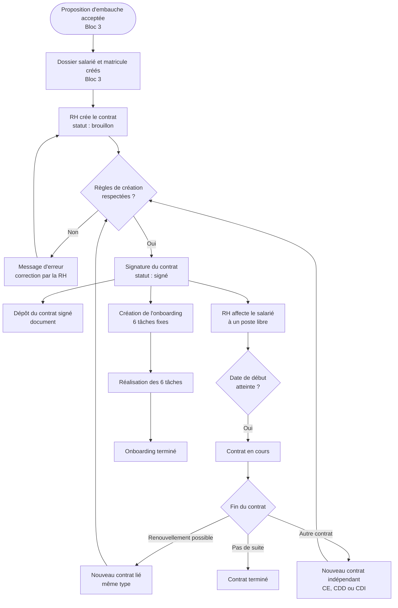
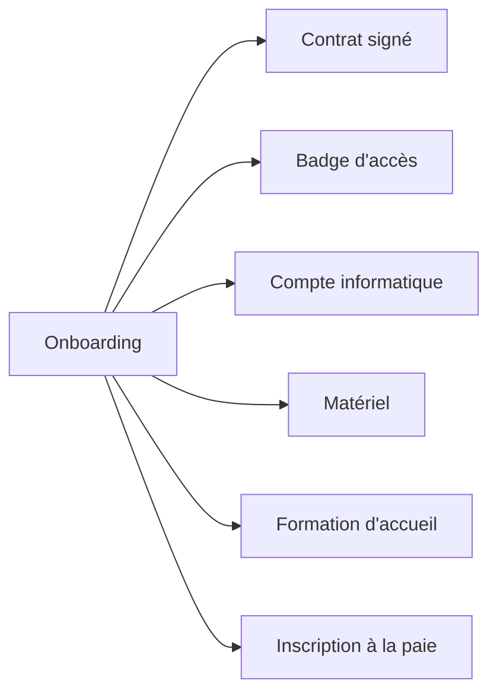
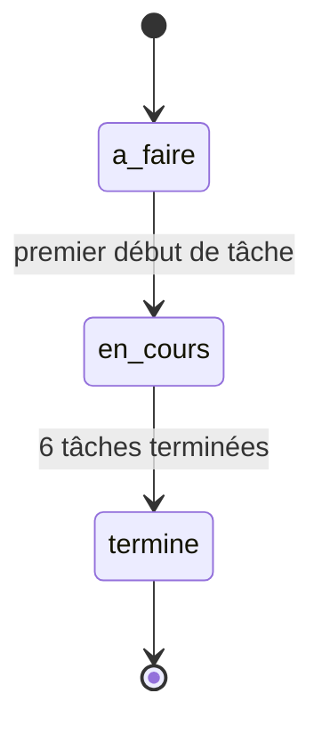
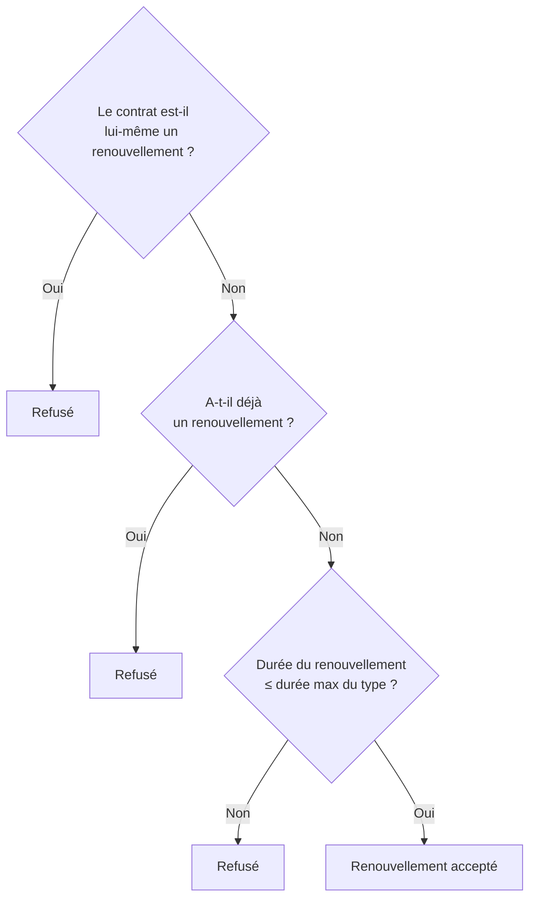
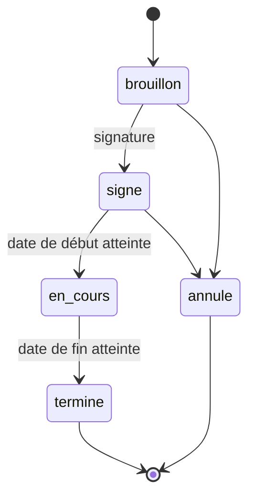
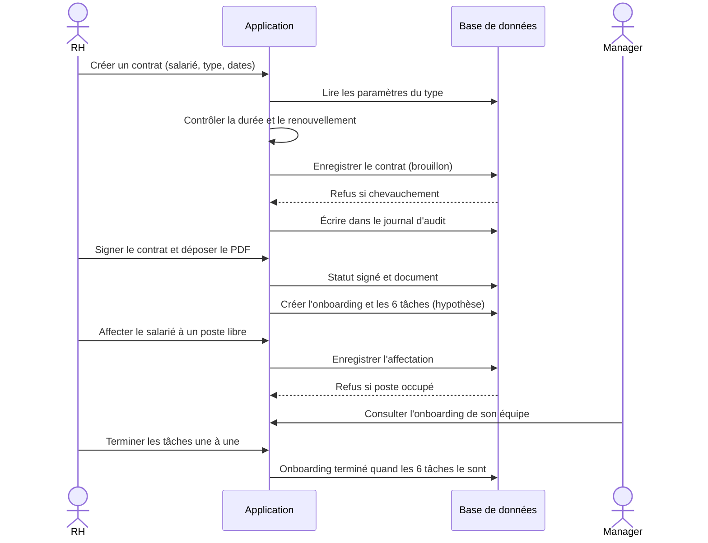

# SIRH Bloc 4 : Workflow complet (Contrat et onboarding)

Ce document décrit le déroulement du Bloc 4 de bout en bout, selon les décisions validées. Les points marqués **(hypothèse)** n'ont pas encore été confirmés.

## 1. Vue d'ensemble

## 2. Les acteurs et leur rôle dans le bloc

| Acteur | Actions dans le Bloc 4 |
|---|---|
| **RH** | Crée, modifie, signe, renouvelle et annule les contrats ; gère les affectations ; dépose les documents ; suit l'onboarding |
| **Manager** | Consulte et participe à l'onboarding de son équipe |
| **Administrateur** | Paramètre les durées et le nombre de renouvellements des contrats |
| **Système** | Contrôle les règles de gestion, crée l'onboarding, enregistre chaque action dans le journal d'audit |

## 3. Étape par étape

### Étape 0 : Déclencheur (Bloc 3)

La proposition d'embauche est acceptée, le dossier salarié et le matricule existent. **Sans salarié, aucun contrat n'est possible** (RG6).

### Étape 1 : Création du contrat

La RH choisit le salarié, le type (CE, CDD, CDI) et les dates. Le statut initial est `brouillon`.

| Contrôle | Règle |
|---|---|
| Durée ≤ durée max du type | CE : 6 mois, CDD : 12 mois, CDI : pas de limite (valeurs lues dans la table de paramètres) |
| CDI sans date de fin | RG5 |
| Pas de chevauchement avec un autre contrat du salarié | RG1 (garanti par la base) |
| `date_fin ≥ date_debut` | Contrôle de cohérence |

### Étape 2 : Signature

Le contrat passe de `brouillon` à `signe`. La RH renseigne la date de signature et dépose le contrat signé (PDF) dans les documents.

### Étape 3 : Création de l'onboarding **(hypothèse)**

À la signature du **premier** contrat du salarié, le système crée un onboarding avec les 6 tâches fixes. Il n'y a qu'un onboarding par salarié, il n'est donc pas recréé aux contrats suivants.

### Étape 4 : Affectation (Développé par Bloc 3, utilisé dans Bloc 4)

La RH affecte le salarié à un **poste libre** à une date de début.

| Contrôle | Règle |
|---|---|
| Le poste n'a pas de titulaire actif | 1 poste = 1 titulaire (garanti par la base) |
| Le salarié n'a pas d'affectation active | 1 seule affectation active (garanti par la base) |

### Étape 5 : Contrat en cours **(hypothèse : changement manuel par la RH)**

À la date de début, la RH passe le contrat de `signe` à `en_cours`.

### Étape 6 : Suivi de l'onboarding

Chaque tâche passe de `a_faire` à `en_cours` puis `termine`, avec un responsable, une échéance et une date de réalisation. Quand les 6 tâches sont terminées, l'onboarding passe à `termine`.

### Étape 7 : Fin de contrat

Trois issues possibles :

| Issue | Ce qui se passe |
|---|---|
| **Renouvellement** | Nouveau contrat lié au précédent (`contrat_precedent_id`), même type, qui commence le lendemain de la fin du précédent |
| **Nouveau contrat indépendant** | Contrat d'un autre type (par exemple un CDD après un CE), sans lien avec le précédent : il est contrôlé séparément |
| **Pas de suite** | Le contrat passe à `termine` |

### Étape 8 : Changement de poste

La RH clôture l'affectation en cours (date de fin renseignée) puis crée la nouvelle. L'ancienne affectation reste dans l'historique : on ne supprime jamais une affectation.

## 4. Règle du renouvellement

Un contrat ne peut être renouvelé qu'une fois, et un renouvellement ne se renouvelle pas.

| Cas | Résultat |
|---|---|
| C1 = 3 mois (CE), pas de renouvellement | Renouvelable |
| C2 = 4 mois, renouvelle C1 | Accepté (4 ≤ 6) |
| C3 renouvelle C2 | Refusé (C2 est déjà un renouvellement) |
| C3 renouvelle C1 | Refusé (C1 a déjà un renouvellement) |
| C2 = 7 mois, renouvelle C1 | Refusé (7 > 6 mois) |

## 5. Statuts du contrat

| De | Vers | Qui | Condition |
|---|---|---|---|
| brouillon | signé | RH | Contrat valide, date de signature renseignée |
| brouillon | annulé | RH | Aucune |
| signé | en_cours | RH | Date de début atteinte |
| signé | annulé | RH | Aucune |
| en_cours | terminé | RH | Date de fin atteinte (jamais pour un CDI sans rupture, traitée dans un bloc ultérieur) |

Un contrat `annule` est ignoré par le contrôle de chevauchement.

## 6. Diagramme de séquence

## 7. Traçabilité

Chaque action du bloc est enregistrée dans `journal_audit` :

| Action | Table concernée |
|---|---|
| Création, modification, signature, annulation, renouvellement | `contrat` |
| Création, clôture | `affectation` |
| Changement de statut d'une tâche ou de l'onboarding | `onboarding_tache`, `onboarding` |
| Ajout d'un fichier | `document` |
| Modification d'un paramètre | `type_contrat` |

## 8. Points encore à confirmer

1. **Statuts du contrat** : changement manuel par la RH (retenu ici) ou automatique selon les dates ?
2. **Création de l'onboarding** : automatique à la signature du premier contrat (retenu ici) ou déclenchée à la main par la RH ?
3. **Tâche « Contrat signé »** : se coche-t-elle automatiquement à la signature, ou la RH la coche-t-elle à la main ?
4. **Manager** : consultation seule, ou peut-il modifier une tâche d'onboarding ?
5. **Continuité du renouvellement** : commence-t-il toujours le lendemain de la fin du précédent ?
6. **Affectation** : « une seule » signifie-t-il une seule active à la fois (retenu ici, avec historique) ?
