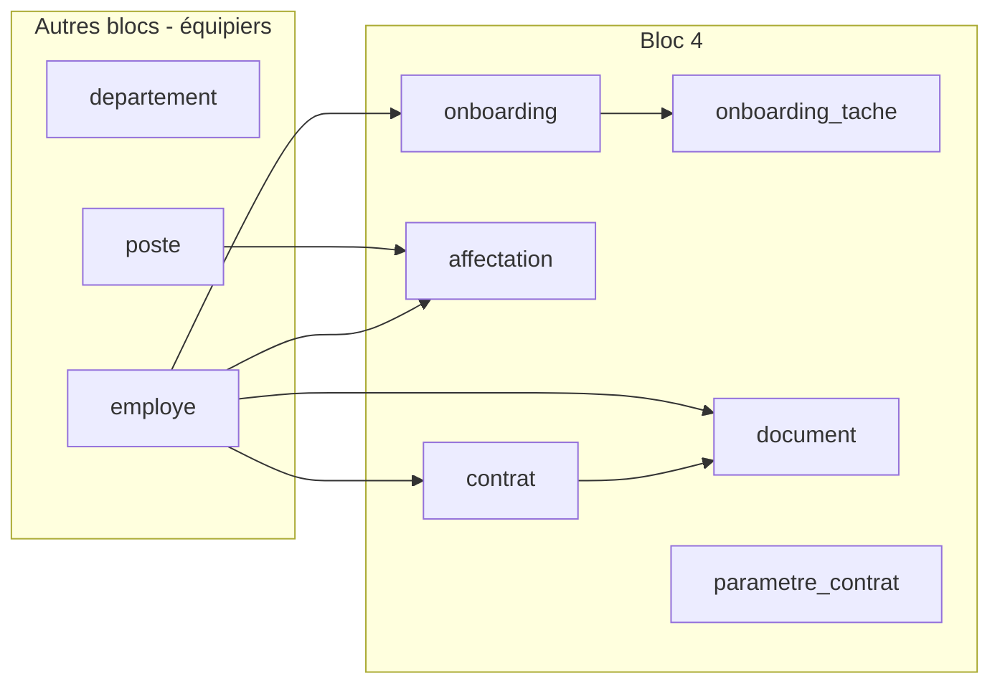
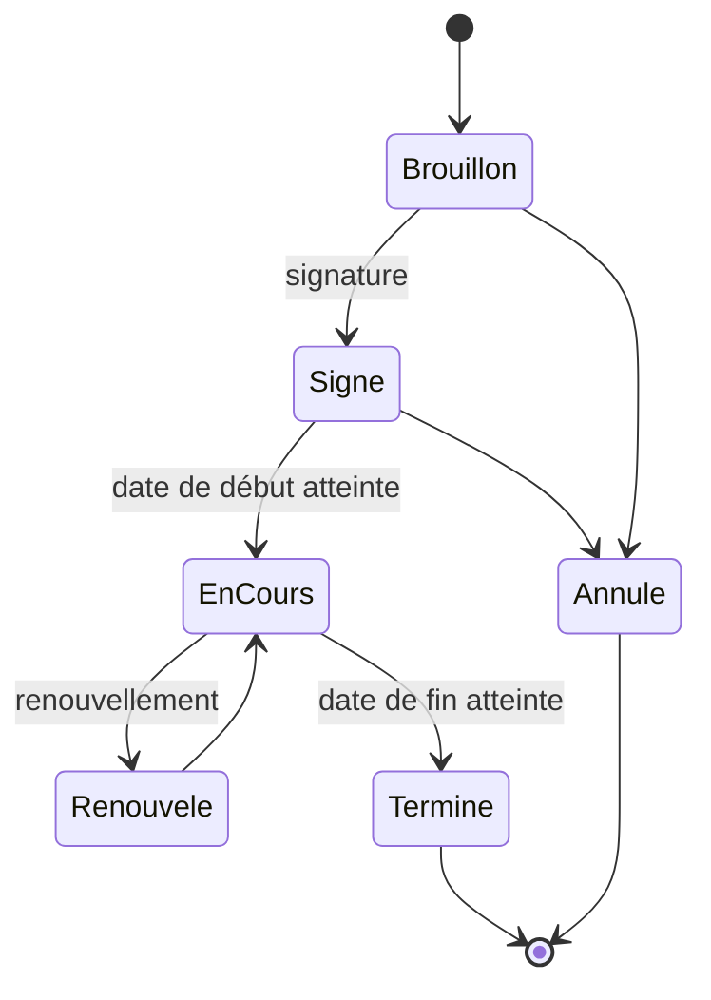
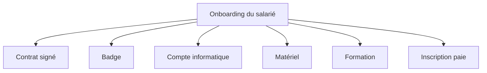

# Analyse fonctionnelle du Bloc 4 (Contrat et onboarding)

Deux points d'interprétation à confirmer :

- **Essai "6 mois + 6 mois maximum"** : 6 mois initial + 1 renouvellement de 6 mois, soit **12 mois au total au maximum**. Les notes initiales disaient "pas plus de 6 mois, renouvelable 1 fois". On retient la dernière réponse.
- **CE et CDD indépendants** : un CDD n'est jamais la suite automatique d'un essai. Chaque contrat est contrôlé séparément.

## 1. Le problème d'équipe à régler d'abord

Le Bloc 4 dépend de données créées par les Blocs 1 à 3 :

**Décision proposée :** l'équipe se met d'accord **dès maintenant** sur les 3 tables partagées (`departement`, `poste`, `employe`) et leurs clés primaires. En attendant, le Bloc 4 peut travailler avec des tables minimales (id + quelques colonnes) et des données de test.

| Option | Avantage | Inconvénient |
|---|---|---|
| Tables minimales partagées dès maintenant | Chacun avance en parallèle | Il faut s'accorder tôt sur les noms |
| Attendre les autres blocs | Pas de doublon | Blocage du Bloc 4 |

Recommandation : la première option.

## 2. Règles de gestion du contrat

| N° | Règle |
|---|---|
| RG1 | Un salarié peut avoir plusieurs contrats **successifs**, jamais deux **actifs en même temps** |
| RG2 | Types : CE (essai), CDD, CDI |
| RG3 | CE : durée par période ≤ 6 mois, 1 renouvellement maximum, **12 mois au total** |
| RG4 | CDD : durée ≤ 2 ans, 1 renouvellement maximum (le total inclut-il le renouvellement ? voir question 2) |
| RG5 | CDI : pas de date de fin |
| RG6 | Un contrat n'a de sens que pour un salarié créé (donc après acceptation de la proposition d'embauche) |
| RG7 | Les limites (6, 12, 24 mois, nombre de renouvellements) viennent de la **table de paramètres**, jamais du code |
| RG8 | Chaque création ou modification de contrat est tracée |

Aucune autre règle du Code du travail malgache n'est inventée ici (périodes minimales, indemnités, etc.). Si le cours ou le cahier des charges en contient, elles seront ajoutées.

## 3. Cycle de vie d'un contrat (statuts)

Le "Renouvelé" est-il un statut, ou un **nouveau contrat lié au précédent** ?

| Approche | Avantage | Inconvénient |
|---|---|---|
| **A. Renouvellement = nouvelle ligne `contrat`** (avec `contrat_precedent_id`) | Historique propre, chaque période a ses dates, comptage simple | Un peu plus de lignes |
| B. Renouvellement = modification des dates du même contrat | Moins de lignes | Perte de l'historique, comptage des renouvellements difficile |

**Recommandation : A**, cohérente avec la note "plusieurs contrats successifs".
`contrat_precedent_id` sert **uniquement** aux renouvellements d'un même type. Il ne relie pas un CE à un CDD (ils sont indépendants).

## 4. Affectation  (Développé par Bloc 3, utilisé dans Bloc 4)

Une affectation relie un **salarié** à un **poste** pendant une période. Puisque **1 poste = 1 titulaire** :

- RG9 : à un instant donné, un poste a au plus une affectation active.
- RG10 : un salarié a au plus une affectation active (à confirmer, voir question 3).
- RG11 : on ne supprime jamais une affectation, on la **clôture** avec une date de fin (historique conservé).

Le lien affectation ↔ contrat est à décider (question 4).

## 5. Onboarding

L'onboarding est la liste des tâches d'intégration d'un nouveau salarié : contrat signé, badge, compte, matériel, formation, inscription paie.

| Notion | Rôle |
|---|---|
| `onboarding` | Un dossier d'intégration par embauche, avec un statut global (À faire, En cours, Terminé) |
| `onboarding_tache` | Une ligne par tâche : responsable, échéance, statut, date de réalisation |
| Modèle de tâches (optionnel) | Liste type de tâches créées automatiquement à chaque embauche |

**Règle proposée :** l'onboarding passe à "Terminé" quand **toutes** les tâches obligatoires sont terminées.

**Sur-ingénierie à éviter en V1 :** pas de moteur de workflow complexe, pas d'intégration automatique avec le badge ou la paie. Une tâche = une case à cocher avec responsable et date.

## 6. Documents

Un `document` est un fichier rattaché à un salarié ou à un contrat (contrat signé PDF, pièce d'identité, etc.). Le **fichier est stocké sur disque**, seuls son chemin et ses métadonnées sont en base.

| Stockage | Avantage | Inconvénient |
|---|---|---|
| Fichier sur disque, chemin en base | Simple, base légère | Sauvegarde du dossier à prévoir |
| Fichier dans PostgreSQL (bytea) | Tout au même endroit | Base lourde, plus complexe |

Recommandation : la première option pour un projet d'apprentissage.

## 7. Les écrans du Bloc 4

| Écran | Utilisateur | Contenu |
|---|---|---|
| Liste des contrats | RH | Filtres par type, statut, salarié |
| Création / modification de contrat | RH | Contrôle des règles RG1 à RG7 |
| Fiche contrat | RH | Détail, historique des renouvellements, documents |
| Renouvellement | RH | Crée le nouveau contrat lié |
| Affectation d'un salarié | RH | Choix du poste libre, dates |
| Onboarding d'un salarié | RH, Manager | Liste de tâches, avancement |
| Paramètres des contrats | Administrateur | Durées et nombre de renouvellements |

## 8. Questions à trancher avant la Phase 3 (modèle de données)

1. **CE : "12 mois au total"**, est-ce bien l'intention ?
2. **CDD : les 2 ans incluent-ils le renouvellement** (2 ans au total) ou est-ce 2 ans par période ?
3. **Un salarié peut-il avoir deux affectations en même temps** (deux postes), ou une seule ?
4. **Affectation et contrat** : l'affectation est-elle liée à un contrat précis, ou seulement au salarié ? Recommandation : lier l'affectation au salarié et au poste, et garder le contrat séparé.
5. **Onboarding** : les tâches sont-elles les 6 définies, fixes, ou la RH peut-elle en ajouter ?
6. **Qui crée le contrat** : seule la RH, ou le manager peut-il le préparer ?

## 9. Améliorations possibles (plus tard)

- Alerte avant la fin d'un contrat (essai ou CDD)
- Génération automatique du PDF de contrat
- Modèles de tâches d'onboarding par type de poste

## Prochaine étape

Après validation des questions 1 à 6 : **Phase 3**, modèle conceptuel et physique des tables du Bloc 4 (PostgreSQL), avec script SQL et diagramme entité-relation.
