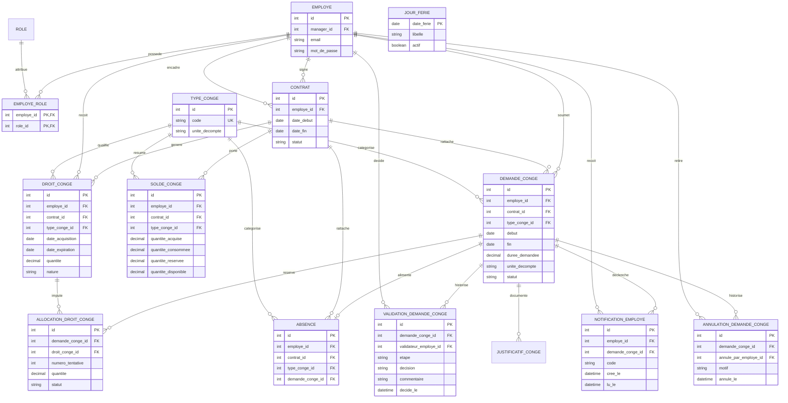

# Bloc 7 — Partie C : MCD du socle

Ce modèle décrit les tables SQL de la partie C, notamment les tranches mensuelles attachées au contrat et le portail salarié. L'acquisition et l'allocation FIFO sont exécutées par les services; le schéma conserve les mouvements nécessaires à leur traçabilité.

## Diagramme

## Entités et règles de liaison

| Entité | Rôle / contrainte |
|---|---|
| `employe`, `role`, `employe_role` | Le compte de connexion reste lié à `employe.id` via les identifiants déjà présents. La relation plusieurs-à-plusieurs permet d'ajouter Salarié à un Manager ou RH sans remplacer ses rôles. |
| `contrat` | Chaque droit et demande est rattaché au contrat concerné. Les clés étrangères composites garantissent que le contrat appartient au même salarié. |
| `droit_conge` | Une ligne représente une tranche ou régularisation. Une acquisition mensuelle vaut 2,5 jours ouvrés et expire trois ans après son acquisition. Les acquisitions futures ne sont pas créées par anticipation. |
| `solde_conge` | Synthèse par contrat et type. Le disponible est acquis moins consommé moins réservé. Un nouveau contrat possède un solde distinct initialement nul ; aucun report entre contrats. |
| `demande_conge` | Demande faite par l'employé connecté pour son propre dossier, sur son contrat courant. L'unité persistée est `jours_ouvres`. |
| `validation_demande_conge` | Historique de décisions. Une demande est routée au manager direct, ou à la RH si le salarié n'a pas de manager ; une seule décision métier est attendue pour chaque soumission. |
| `allocation_droit_conge` | Allocation d'une demande vers les tranches de droits, conservant quantités réservées, consommées ou libérées pour appliquer le FIFO et tracer les corrections/retraits. |
| `notification_employe` | Notification applicative liée au destinataire et, si pertinent, à la demande. |
| `annulation_demande_conge` | Audit des retraits par le salarié avant approbation et des annulations RH après approbation. |
| `absence` | Donnée de suivi raccordée à la demande approuvée et au même contrat. |
| `jour_ferie` | Calendrier servant au calcul des jours ouvrés, à alimenter selon le calendrier applicable. |

## Contraintes métier exécutées par les services

- Créditer 2,5 à chaque anniversaire mensuel complet depuis le début du contrat ; ne pas proratiser un mois incomplet.
- Expirer une tranche à sa date d'expiration, sans suspension liée au refus d'une demande, et allouer les consommations annuelles en FIFO parmi les tranches encore valides.
- Le contrôle de demande utilise uniquement le solde acquis à l'instant de soumission ; les congés maladie et exceptionnels ne déduisent pas le solde annuel.
- Une demande retournée pour correction, resoumise, refusée ou retirée doit préserver l'historique. Toute réservation libérée doit être répercutée au solde dans la même transaction.
- L'unité `jours_ouvres` est imposée dans le SQL ; elle suppose une définition cohérente des jours fériés et du calendrier.

## Limites du modèle

La génération planifiée doit exécuter `php spark conges:acquerir` quotidiennement. Les informations de compte salarié réutilisent `employe.email` et `employe.mot_de_passe`; la RH peut activer ou réinitialiser le compte depuis l'écran dédié. L'email de notification, la récupération autonome du mot de passe, les règles de conservation des justificatifs et la modification d'un congé déjà approuvé restent hors périmètre actuel.
