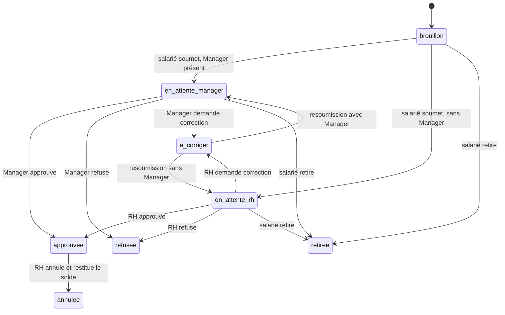

# Bloc 7 — Partie C : règles et workflow validés

## Règles de solde

- Le congé annuel acquiert **2,5 jours ouvrés** par mois complet de service à partir du début du contrat. Un mois est complet à chaque anniversaire mensuel du contrat; le crédit est créé à cette date.
- Les droits sont acquis après chaque mois complet; aucune attente de douze mois n'est appliquée.
- Chaque crédit mensuel constitue une tranche distincte, valable jusqu'à son troisième anniversaire. Elle n'est plus utilisable à partir de sa date d'expiration. Le calcul d'une demande consomme d'abord les tranches les plus anciennes encore valides (FIFO).
- Un nouveau contrat ouvre un nouveau solde initialisé à zéro. Aucun reliquat du contrat précédent n'est transféré, même en cas de renouvellement.
- Les demandes de congé maladie et exceptionnel ne déduisent pas le solde annuel. Les 2,5 jours mensuels alimentent le type « Congé annuel » uniquement.
- Le solde d'une demande future est vérifié à la date de demande; les acquisitions qui surviendraient avant la date du congé ne sont pas anticipées.
- L'unité est le jour ouvré pour l'acquisition et la consommation : lundi à vendredi, hors jours fériés configurés; une demi-journée vaut 0,5. Cette unité choisie pour le projet est à distinguer du libellé légal malgache en jours calendaires.

## Accès et validation

- Chaque salarié dispose d'un compte lié à son dossier employé et consulte uniquement son solde, ses demandes et ses notifications.
- Un employé peut cumuler le rôle Salarié avec Manager ou RH afin de conserver son accès personnel.
- À la soumission, une demande est envoyée au Manager direct s'il existe; sinon, elle est envoyée à la file RH. Il n'y a pas de seconde validation obligatoire après l'approbation du Manager.
- Le validateur peut approuver, refuser ou retourner la demande pour correction. Le créateur peut corriger puis soumettre à nouveau. Les refus ne modifient ni l'acquisition ni la date d'expiration des droits.
- Les notifications sont internes à l'application : à la soumission vers le validateur, puis après décision vers le salarié. Un envoi par courriel reste un canal futur éventuel.

## Parcours d'une demande

| Étape | Traitement | Effet |
|---|---|---|
| 1. Acquisition mensuelle | À chaque anniversaire mensuel d'un contrat admissible, produire un mouvement annuel de 2,5 jours ouvrés avec expiration à trois ans. | Solde courant recalculé à partir des tranches non expirées du contrat courant. |
| 2. Nouveau contrat | Créer un compte de solde distinct lié au nouveau contrat. | Le solde du nouveau contrat commence à zéro; aucun droit antérieur ne passe au nouveau contrat. |
| 3. Demande salarié | Le salarié choisit un type, des dates/portions et fournit les renseignements ou justificatifs requis. Le système sélectionne le contrat actif et calcule la durée en jours ouvrés. | Brouillon puis soumission; le salarié voit son statut. |
| 4. Contrôles à la soumission | Vérifier le contrat actif, le chevauchement et, pour le congé annuel seulement, le solde déjà acquis non expiré. Une pièce jointe peut être ajoutée, mais elle n'est jamais obligatoire. | Seul le congé annuel réserve le solde annuel; maladie et exceptionnel ne créent pas de débit annuel. Pas de projection d'acquisitions futures. |
| 5. Routage | Avec Manager direct : notifier ce Manager. Sans Manager : notifier la RH. | Statut `en_attente_manager` ou `en_attente_rh`. |
| 6. Décision unique | Le Manager assigné ou un RH approuve, refuse ou demande une correction. Refus et correction exigent un commentaire. | Approbation : demande close et absence créée. Refus : réservation libérée. Correction : retour au salarié, puis recontrôle à la resoumission. |
| 7. Retrait | Le salarié peut retirer sa demande tant qu'elle n'est pas approuvée; la RH peut annuler après approbation avec motif. | Réservation libérée; si déjà approuvée, absence annulée et mouvement d'annulation audité. |

## Limites explicites

- « Refus de congé » n'est pas traité comme une suspension ou exception à la règle d'expiration : une tranche reste soumise à sa date d'expiration. Les décisions et motifs restent historisés.
- Fin de contrat sans renouvellement : l'indemnisation éventuelle des droits non pris relève de la paie et n'est pas gérée ici.
- Le système devra distinguer les contrats brouillon/annulés, qui ne produisent aucun droit, des contrats signés, en cours ou terminés qui possèdent une période de service effective.
- La commande `php spark conges:acquerir` rattrape les tranches manquantes et recalcule les soldes de tous les salariés actifs ; elle doit être planifiée quotidiennement. Les consultations et soumissions synchronisent aussi les droits du salarié concerné.
- Les jours fériés actifs sont tenus à jour par la RH. Le calendrier et les notifications par courriel nécessitent leurs propres règles/intégrations.
