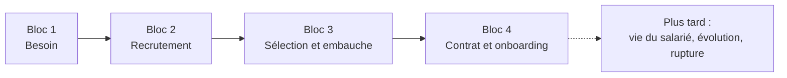
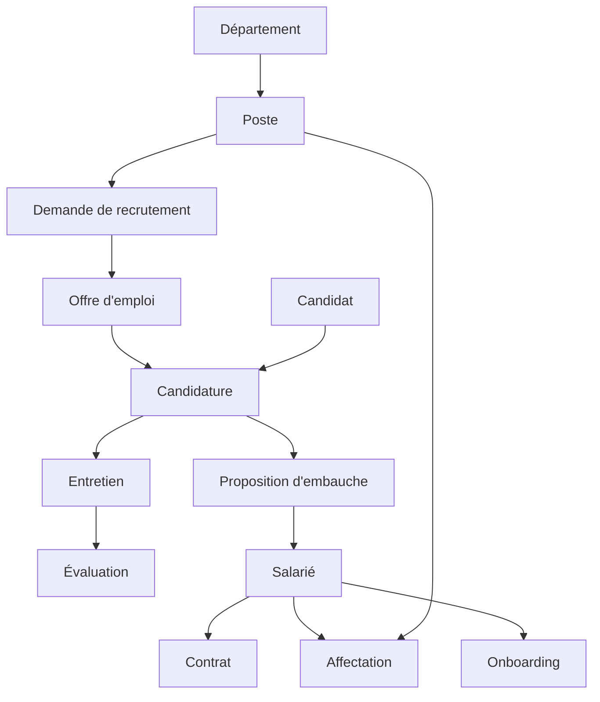

# Cadrage

## 1. Périmètre de la version 1

**Inclus dans la V1 :** organisation (départements, postes), demande de recrutement et validation, offre, candidats, candidatures, entretiens, évaluations, proposition d'embauche, dossier salarié, contrat, affectation, onboarding, documents, traçabilité.

## 2. Les acteurs

| Acteur | Rôle dans le processus |
|---|---|
| **Manager** | Exprime le besoin, participe aux entretiens |
| **RH** | Instruit les demandes, publie les offres, gère candidatures, contrats, dossiers |
| **Direction** | Valide ou refuse les demandes de recrutement |
| **Candidat** | Postule (pas d'accès à l'application en V1, ses données sont saisies par les RH) |
| **Salarié** | Sujet du dossier, pas d'accès en V1 |
| **Administrateur** | Gère les référentiels et les utilisateurs |

**Décision à prendre :** seuls Manager, RH, Direction et Administrateur se connectent en V1 (Avantage : écrans et sécurité simples.) ou portail candidat?

## 3. Glossaire

| Terme | Définition |
|---|---|
| **Poste** | Fonction définie dans l'organisation, qui existe même s'il est vacant |
| **Employé / Salarié** | Personne liée à l'entreprise par un contrat |
| **Candidat** | Personne qui postule, pas encore salariée |
| **Demande de recrutement** | Besoin exprimé par un manager, soumis à validation |
| **Offre d'emploi** | Annonce publiée suite à une demande validée |
| **Candidature** | Lien entre un candidat et une offre |
| **Affectation** | Lien entre un salarié et un poste sur une période |
| **Matricule** | Identifiant unique du salarié, créé à l'embauche |

## 4. Objets métier identifiés

Deux principes à respecter :

- **Poste ≠ Employé** : un poste est lié à un salarié uniquement via une *affectation*.
- **Candidat ≠ Employé** : le salarié est *créé* à partir d'un candidat, il ne le remplace pas.

## 5. Règles de gestion

| Règle |
|---|
| Essai : 6 mois max + renouvellement 6 mois max, renouvellement 1 fois max |
| CDD ≤ 1 ans max + renouvellement 1 ans max, renouvelable 1 fois |
| CDI sans durée maximale |
| Les durées sont stockées dans une table de paramètres |
| CE et CDD sont indépendants |
| Un salarié peut avoir plusieurs contrats successifs |
| Un refus à une étape de validation met fin à la demande de recrutement |
| Un poste = un seul titulaire (5 développeurs = 5 postes) |
| Toutes les actions sont tracées |
| Le matricule est créé après acceptation de la proposition |
